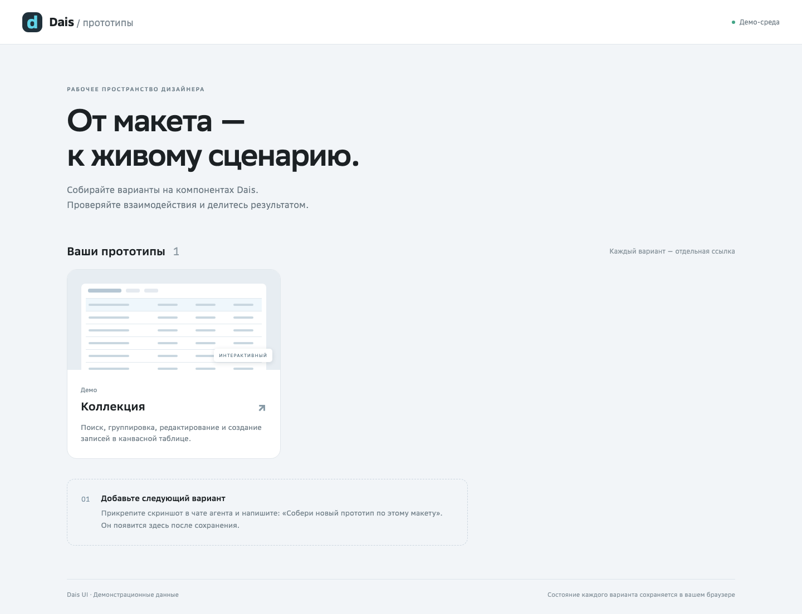
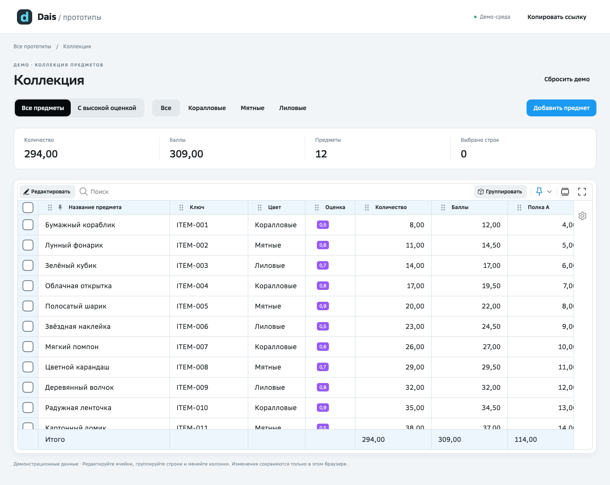

# Dais · прототипы

Готовое рабочее место дизайнера: **Vite + React + Dais UI + локальный MCP + три навыка агента**.
Прикрепляйте макеты в чат Codex, Claude Code или поддерживаемого клиента GigaCode, собирайте интерактивные варианты и публикуйте галерею на GitHub Pages.



## Первый запуск

1. Нажмите **Use this template → Create a new repository** вверху GitHub-страницы. Назовите свою копию, например `my-prototypes`. Для бесплатного GitHub Pages используйте публичный репозиторий с демонстрационными данными. [Инструкция GitHub с картинками](https://docs.github.com/en/repositories/creating-and-managing-repositories/creating-a-repository-from-a-template).
2. Склонируйте **свой** репозиторий и откройте папку в агенте. Скачанный ZIP тоже можно запустить локально, но для публикации потребуется Git-репозиторий.
3. Нужен [Node.js](https://nodejs.org/en/download) **22.14+ из ветки 22 или 24+** с npm. Если уже установлен nvm: `nvm install && nvm use`. Для публикации также нужны [Git](https://git-scm.com/downloads) и [GitHub CLI](https://cli.github.com/).
4. Напишите агенту:

   > Прочитай AGENTS.md и подготовь проект для прототипирования по навыку dais-setup.

   Или выполните в терминале:

   ```sh
   npm run setup
   npm run dev
   ```

5. Перезапустите агент в этой папке после настройки MCP. При запросе клиента разрешите работу с проектом и сервером `dais-ui`. Откройте локальную ссылку, напечатанную Vite.

Подготовка устанавливает пакеты из lockfile, создаёт конфиги MCP **только внутри проекта** и проверяет соединение. Повторная подготовка сохраняет макеты. Ничего не устанавливается в исходные репозитории Dais, Plasma или Glide.

## Собрать макет

Прикрепите PNG в чат агента и напишите:

> Собери новый прототип «План команды» по этому скриншоту. Используй Dais UI и настоящую TableCanvas. Нужны поиск, группировка и редактирование. Сохрани предыдущие варианты.

Агент создаст папку в `src/prototypes`. Галерея автоматически покажет новый вариант. Для создания вручную:

```sh
npm run prototype:new -- team-plan "План команды"
```

Адрес варианта: `http://localhost:5173/#/team-plan` (порт смотрите в терминале).
PNG задаёт внешний вид; поведение невидимых состояний лучше указать одной фразой. Клиент/модель должны поддерживать изображения и выполнение команд. Один skill не добавляет эти возможности модели.



В стартовой коллекции работают создание записи, поиск, фильтр по цвету, группировка, сортировка, выбор строк, редактирование и итоги. Данные сохраняются в localStorage этого браузера. «Сбросить демо» восстанавливает исходные записи. Коллеги получают данные из опубликованного кода, а не ваши изменения localStorage.

## Что такое репозиторий и localStorage

**Репозиторий** — папка проекта с кодом, картинками и историей изменений. Этот репозиторий служит шаблоном; дизайнер создаёт из него собственную копию. «Репозиторий проекта» в командах публикации означает именно копию, открытую в агенте. Адрес GitHub, куда уйдёт код, показывает `git remote -v`.

**localStorage** — встроенное хранилище браузера на устройстве посетителя. В стартовом примере оно хранит строки таблицы: названия предметов, их цвет, оценку, количество, баллы и значения двух полок, включая добавленные записи и изменения ячеек. Это нужно, чтобы продолжить демонстрацию после перезагрузки страницы. Поиск, текущий фильтр и выделение строк приложение туда не записывает.

У каждого варианта свой ключ хранения. На GitHub и другим участникам изменения из localStorage не отправляются; у другого браузера будет собственное состояние. «Сбросить демо» заменяет сохранённые строки исходными вымышленными данными. Полностью удалить запись можно через инструменты браузера: Application → Local Storage → ключ `dais-prototype:collection:v1`. Хранилище не используется для паролей, токенов или PNG из чата.

## Опубликовать

Напишите: **«Опубликуй прототипы в мой репозиторий и дай ссылку»**.

При первом запуске войдите в GitHub через `gh auth login`; агент не должен просить ваш токен в чате. Дальше он проверит проект, включит Pages, отправит commit и дождётся GitHub Actions. [Пошаговая инструкция](docs/PUBLISHING.md).

## Агенты

| Клиент | Навыки | MCP после setup |
| --- | --- | --- |
| Codex | `.agents/skills` | `.codex/config.toml` |
| Claude Code | `.claude/skills` | `.mcp.json` |
| GigaCode CLI | `.gigacode/skills` | `.gigacode/settings.json` |
| GigaCode VS Code | Если не обнаружены, попросите прочитать SKILL.md | `.gigacode_vsc/gigacode.jsonc` |

Исходник навыков один: `.agents/skills`; копии для клиентов обновляются `npm run skills:sync`.
Конфиги MCP содержат пути вашего компьютера, поэтому исключены из git. Для нового клона выполняйте setup заново.
Файлы для клиентов подготовлены по официальной документации. Реальная активация и передача PNG зависят от версии/политик клиента; актуальные границы проверки перечислены в [отчёте](docs/VALIDATION.md).

## Проверки и команды

```sh
npm run doctor          # версии и независимость зависимостей
npm run mcp:check       # реальные обращения к MCP
npm run build           # TypeScript + production build
npm test                # сохранность настроек и макетов
npx playwright install chromium
npm run test:browser    # сценарии в браузере после build
```

Если npm не найден — установите Node и откройте терминал заново. Если MCP не появился — перезапустите агент и проверьте его доверие проекту. Не используйте `--force`/`--legacy-peer-deps` для исправления установки: lockfile должен работать без них.

Обновление пакетов выполняется отдельно и проверяется на существующих вариантах. [Как поддерживать шаблон](docs/MAINTAINING.md).

## Устройство

- `src/prototypes/` — независимые варианты дизайнера.
- `src/recipes/` — общая рабочая композиция таблицы и демонстрационные данные.
- `scripts/` — подготовка, диагностика, создание варианта и публикация.
- `.agents/skills/` — подготовка, сборка макетов, публикация.
- `.github/workflows/pages.yml` — проверки и размещение на Pages из `main`.

Это приложение-потребитель `@daisforge/ui`. Plasma и форк Glide устанавливаются как зависимости Dais. MCP нужен агенту при разработке; опубликованная страница работает без агента и MCP.
